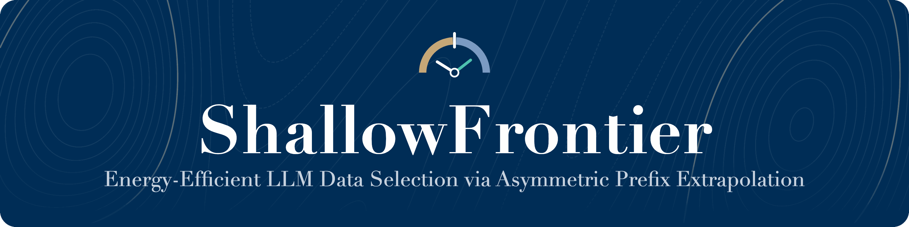
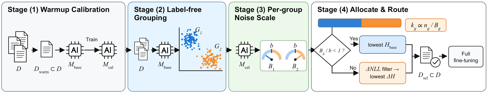
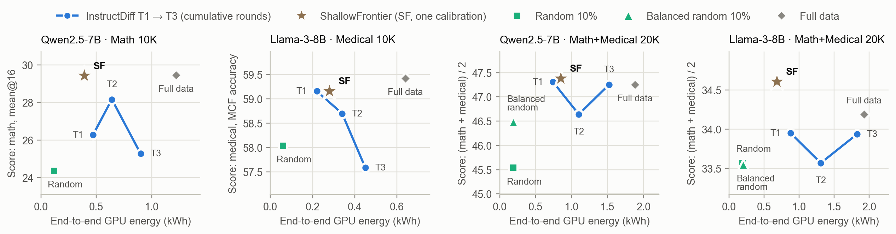
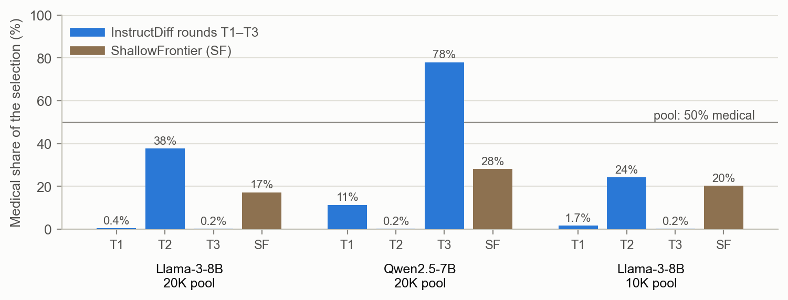

<p align="center">
  <a href="README.md">English</a>&nbsp;&nbsp;|&nbsp;&nbsp;<b>한국어</b>
</p>

<p align="center">
  
</p>

<p align="center">
  <a href="https://aclanthology.org/2026.acl-long.486/"></a>
  <a href="#결과"></a>
  <a href="LICENSE"></a>
  
  <a href="https://github.com/hufs24lsh/data-selection/actions/workflows/ci.yml"></a>
</p>

<p align="center">
  <b>Seungho Lee</b>&nbsp;&nbsp;·&nbsp;&nbsp;<b>Suchan Yang</b><br>
  LAIGHT · 한국외국어대학교
</p>

<p align="center">
  <a href="#개요">개요</a>&nbsp;&nbsp;·&nbsp;&nbsp;<a href="#결과">결과</a>&nbsp;&nbsp;·&nbsp;&nbsp;<a href="#빠른-시작">빠른 시작</a>&nbsp;&nbsp;·&nbsp;&nbsp;<a href="docs/method.md">방법 (영문)</a>&nbsp;&nbsp;·&nbsp;&nbsp;<a href="docs/evaluation.md">평가 (영문)</a>&nbsp;&nbsp;·&nbsp;&nbsp;<a href="#재현성">재현성</a>&nbsp;&nbsp;·&nbsp;&nbsp;<a href="#인용">인용</a>
</p>

> [!TIP]
> **한 줄 요약.** InstructDiff는 *보정 → 선택 → 학습*을 세 번 반복하고 그중 가장 좋은 회차를 씁니다. ShallowFrontier는 **한 번만**
> 보정하고, 질문 묶음마다 기울기 잡음으로 **학습 국면**을 읽어 국면에 맞게 다르게 고릅니다. 4개 실험 설정에서 InstructDiff의 최고
> 회차와 같거나 높은 성능을 내면서 **전 과정 GPU 에너지를 53% 줄였습니다** (seed 42).

## 소식

- **2026-11-11** · 코드, 실험 설정, 결과를 공개했습니다: 전체 데이터·무작위 기준선을 포함한 seed 42 표와 모든 실험 설정의
  3 seed 평균 ± 표준편차.

## 개요

<p align="center">
  
</p>

**왜 중요한가.** 데이터 선별은 계산을 아끼려는 일이지만, 선별 자체의 비용은 잘 따지지 않습니다. 선별 계산까지 포함하면 강력한 선별
방법 다수가 거의 계산 최적이 아니고([Yin & Rush, ICLR 2025](https://arxiv.org/abs/2410.16208)), 보통 공개되지 않는 개발 과정의
비용이 최종 학습의 약 절반에 이르며([Morrison 외, ICLR 2025](https://arxiv.org/abs/2503.05804)), 에너지 수치 없는 효율 주장은
불완전합니다([Chiu, ICML 2026](https://icml.cc/virtual/2026/poster/67123)). 그래서 이 저장소는 모든 방법의 전 과정 GPU 에너지를
선별까지 포함해 보고합니다.

ShallowFrontier는 지시 학습(instruction tuning) 데이터에서 10%를 골라 전체 미세조정(full fine-tuning)에 씁니다.
[InstructDiff](https://aclanthology.org/2026.acl-long.486/) (Su et al., ACL 2026)처럼 보정을 여러 회차 반복하는 대신 **얕은 보정을
한 번만** 하고, **질문(프롬프트)만 보고** 데이터를 묶은 뒤, 묶음마다 **학습 국면**을 잽니다. 학습 국면은 묶음의 기울기 잡음 크기
*B*가 학습 배치 크기 *b*보다 작은지 큰지로 정합니다. 경계 아래(기초 국면)의 묶음은 가장 쉬운 행을, 경계 위(심화 국면)의 묶음은
InstructDiff의 대조 엔트로피 순서를 따릅니다. 묶음의 몫은 *n / B*에 비례하므로 어떤 묶음도, 혼합 데이터의 어떤 분야도 굶지 않습니다.
분야 표시, 정답, 데이터에 맞춘 상수는 쓰지 않습니다.

| 단계 | 하는 일 | 코드 |
|---|---|---|
| **1 · 워밍업 보정** | 무작위 10%(InstructDiff의 워밍업 규칙)로 보정 모델 M_cal을 한 번 학습 | [`scripts/train.py`](scripts/train.py) |
| **2 · 라벨 없는 묶기** | 기본 모델이 읽은 질문 표현에 코사인 k-means, 실루엣이 0.25 아래면 한 묶음으로 둠 | [`grouping.py`](src/shallowfrontier/grouping.py) |
| **3 · 묶음별 잡음 크기** | M_cal에서 묶음마다 기울기 잡음 크기 *B*를 선택이 굳을 때까지 측정 | [`noise.py`](src/shallowfrontier/noise.py) |
| **4 · 배분과 경로** | 몫 *k ∝ n / B*, *B < b*이면 H_base가 가장 낮은 행, 아니면 ΔNLL 필터 뒤 ΔH가 가장 낮은 행 | [`selection.py`](src/shallowfrontier/selection.py) |

<details>
<summary><b>왜 두 가지 경로인가?</b></summary>

<br>

gradient noise scale *B*는 데이터별 gradient가 서로 엇갈리는 정도를 평균 내서 지우는 데 필요한 데이터 수입니다. *B < b*이면 한
batch 안에서 엇갈림이 이미 지워집니다. 그 group에 남은 학습은 공통 방향(대개 답의 형식)이고, base 모델이 가장 쉽게 여기는 데이터가
그 방향을 가장 깨끗하게 보여 줍니다. *B ≥ b*이면 데이터마다 다른 방향을 가리키며 각자의 내용을 담고 있어서, base 모델과 calibration
모델의 차이를 보는 InstructDiff 규칙이 아직 배울 거리가 있는 데이터를 고릅니다. 같은 Qwen 수학 데이터에서 학습 설정만 바꾸면
*B / b*가 0.27에서 1.49로 바뀌고, 이기는 규칙도 뒤집힙니다(+2.22점, −1.84점, seed 42). 근거와 한계:
[`docs/method.md`](docs/method.md#6-why-two-routes) (영문).

</details>

<details>
<summary><b>왜 먼저 묶는가?</b></summary>

<br>

*B*는 데이터 하나가 아니라 데이터 묶음의 성질입니다. 풀 전체로 *B*를 하나만 재면 풀 전체에 규칙 하나만 적용되고, 선택 수를 나눌
단위도 없어집니다. 우리 풀에서는 전체로 잰 *B*도 group별 값과 같은 경로를 골랐으므로, 묶음의 이득은 *n / B* 배분에서 나옵니다.
Llama-3-8B 혼합 데이터에서 풀 전체를 점수 하나로 줄 세우면 의학 데이터가 거의 남지 않아 30.36과 29.70에 그치고, 묶으면 34.61과
34.05입니다(seed 42). 묶음이 있으면 묶음마다 작은 표본만 재도 됩니다. 질문(prompt) 묶음은 분야 표시 없이 분야를 97–99% 정확하게
되찾지만, gradient 공간에서 가장 알맞은 단위인지는 아직 직접 시험하지 않았습니다. 자세한 내용:
[`docs/method.md`](docs/method.md#7-why-group-first) (영문).

</details>

<details>
<summary><b>이름의 뜻</b></summary>

<br>

*Shallow*: 보정 학습은 한 번, 반복 없음. *Frontier*: 국면 경계 *B = b* (임계 배치 크기, McCandlish et al., 2018).
*Asymmetric*: 묶음마다 경로와 몫이 다름. *Prefix*: 묶음은 각 예시의 앞부분인 질문에서 나오고, 묶을 때 답변은 읽지 않음.
*Extrapolation*: 선택이 굳을 때까지만 잰 작은 표본으로 묶음 전체의 국면을 정하고, 짧은 보정 학습으로 전체 미세조정에 필요한 것을 예측함.

</details>

## 핵심 결과

- **InstructDiff보다 전 과정 GPU 에너지 53% 절감** (데이터 선택 + 최종 미세조정, NVML 측정, 4개 실험 설정 평균: 0.55 대 1.17 kWh).
  InstructDiff의 최고 회차는 세 회차를 모두 돌린 뒤에야 알 수 있으므로, 그 비용은 세 회차의 비용으로 셉니다.
- **전체 데이터 학습보다 에너지 61% 절감** (0.55 대 1.42 kWh). 성능은 단일 분야 데이터에서 0.3점 이내이고, 혼합 데이터에서는 더
  높습니다 (seed 42).
- **라벨도 정답도 필요 없음.** 기본 모델이 질문을 읽은 은닉 상태로 묶음을 만듭니다. 수학+의학 혼합 데이터는 분야 표시 없이
  순도 97–99%의 묶음으로 나뉩니다.
- **맞춘 값이 아니라 잰 값.** 경로 문턱(*B/b = 1*), 실루엣 하한(0.25), 멈춤 규칙은 이론이나 교과서에서 왔고, 우리 데이터에 맞춘 값은
  없습니다.
- **굶는 분야 없음.** 혼합 데이터(의학 50%)에서 InstructDiff의 회차들은 의학 비율이 0.2%부터 78%까지 흔들리지만, ShallowFrontier는
  17–28%를 지킵니다 (seed 42).
- **바이트 단위 재현.** 저장된 점수와 특징으로 돌린 공개 코드가 선택 15개(실험 설정 5개 × seed 3개), 보정 표본 17개, 혼합 데이터
  2개를 바이트 단위까지 똑같이 재현합니다.

## 결과

> [!NOTE]
> 본표는 모든 방법과 실험 설정에 같은 seed 42를 쓰고, 3 seed(42–44) 평균 ± 표준편차는 아래에 싣습니다.

점수: 수학은 mean@16, 의학은 객관식(MCF) 정확도, 혼합 데이터는 둘의 평균. E2E kWh: 데이터 선택 + 최종 미세조정에 쓴 GPU 에너지
측정값. **굵은 글씨**: 10% 선택 방법 중 최고.

| 방법 | Qwen2.5-7B · 수학 1만 | kWh | Llama-3-8B · 의학 1만 | kWh | Qwen2.5-7B · 혼합 2만 | kWh | Llama-3-8B · 혼합 2만 | kWh |
|---|---:|---:|---:|---:|---:|---:|---:|---:|
| 기본 모델 | 12.06 | – | 62.22 | – | 39.15 | – | 32.21 | – |
| 전체 데이터 (Full data) | 29.44 | 1.22 | 59.42 | 0.64 | 47.25 | 1.88 | 34.19 | 1.93 |
| 무작위 10% (Random) | 24.36 | 0.12 | 58.04 | 0.06 | 45.54 | 0.19 | 33.57 | 0.19 |
| 균형 무작위 10% (Balanced random, 분야별 절반) | – | – | – | – | 46.49 | 0.19 | 33.55 | 0.20 |
| InstructDiff T1 | 26.27 | 0.47 | **59.16** | 0.22 | 47.31 | 0.74 | 33.95 | 0.88 |
| InstructDiff T2 | 28.16 | 0.64 | 58.70 | 0.34 | 46.64 | 1.10 | 33.57 | 1.31 |
| InstructDiff T3 (세 회차 모두) | 25.27 | 0.90 | 57.59 | 0.45 | 47.25 | 1.52 | 33.94 | 1.83 |
| **ShallowFrontier** | **29.42** | 0.39 | **59.16** | 0.28 | **47.38** | 0.85 | **34.61** | 0.68 |

- 의학 단독 데이터에서 ShallowFrontier는 InstructDiff T1과 정확히 같은 행을 고릅니다(묶음 하나, *B/b* > 1). 그래서 점수가 같습니다.
- 의학 단독 데이터에서는 MCF 채점으로 미세조정한 모든 모델이 기본 모델보다 낮습니다. 데이터 선택은 얼마나 적게 잃는지를 정합니다.

**3 seed 평균** (seed 42–44, 평균 ± 표준편차, **굵은 글씨**: 10% 선택 방법 중 최고):

| 방법 | Qwen2.5-7B · 수학 1만 | Llama-3-8B · 의학 1만 | Qwen2.5-7B · 혼합 2만 | Llama-3-8B · 혼합 2만 |
|---|---:|---:|---:|---:|
| 무작위 10% (Random) | 24.38 ± 0.80 | **58.99 ± 0.83** | – | – |
| 균형 무작위 10% (Balanced random, 분야별 절반) | – | – | 46.27 ± 0.44 | 33.85 ± 0.51 |
| InstructDiff T1 | 26.06 ± 0.28 | 58.58 ± 0.74 | **47.23 ± 0.12** | 33.87 ± 0.08 |
| InstructDiff T2 | 28.18 ± 0.20 | 58.02 ± 0.60 | 46.07 ± 0.50 | 33.40 ± 0.27 |
| InstructDiff T3 | 25.31 ± 0.39 | 58.02 ± 0.65 | 47.14 ± 0.11 | 34.05 ± 0.12 |
| **ShallowFrontier** | **29.13 ± 0.57** | 58.58 ± 0.74 | 47.01 ± 0.32 | **34.15 ± 0.42** |

InstructDiff 최고 회차와 비교하면 ShallowFrontier는 수학에서 +0.95, 의학에서는 같습니다(T1과 같은 데이터).
Qwen2.5-7B 혼합 데이터에서는 0.22 낮지만 seed 사이 변동(표준편차 0.32) 안이고, Llama-3-8B 혼합 데이터에서는 +0.10입니다. 의학 단독
데이터에서는 무작위 10%의 3 seed 평균이 가장 높습니다.

<p align="center">
  
</p>
<p align="center">
  
</p>

**혼합 데이터의 문제 사례 (Llama-3-8B, 1만 데이터, seed 42).** InstructDiff의 세 번째 회차는 1,000행 중 의학을 2행만 남기고, 점수가
28.96으로 떨어집니다(MedQA 35.27, 거의 찍기 수준). ShallowFrontier는 203행을 남기고 34.05를 얻습니다.

| 방법 | 점수 | kWh |
|---|---:|---:|
| 균형 무작위 10% (Balanced random) | 33.06 | 0.10 |
| InstructDiff T1 / T2 / T3 | 33.01 / 33.34 / 28.96 | 0.43 / 0.65 / 0.90 |
| **ShallowFrontier** | **34.05** | 0.35 |

3 seed 평균: 균형 무작위 33.41 ± 0.40, InstructDiff T1 / T2 / T3 32.85 ± 0.58 / 33.31 ± 0.47 / 31.20 ± 2.06, ShallowFrontier
33.81 ± 0.22.

<details>
<summary><b>벤치마크별 점수 (seed 42)</b></summary>

<br>

`results/seed42.json`으로 만든 표입니다. 아직 결과가 없는 행은 뺐습니다.

**Qwen2.5-7B · 수학 1만**

| 방법 | MATH500 | Minerva | OlympiadBench | AIME24 | AMC23 | 수학 평균 |
|---|---:|---:|---:|---:|---:|---:|
| 기본 모델 | 26.66 | 8.43 | 8.04 | 1.24 | 15.94 | 12.06 |
| 전체 데이터 (Full data) | 59.97 | 21.01 | 24.36 | 6.25 | 35.62 | 29.44 |
| 무작위 10% (Random) | 54.19 | 12.04 | 20.59 | 3.75 | 31.25 | 24.36 |
| InstructDiff T1 | 56.23 | 14.22 | 23.03 | 5.83 | 32.03 | 26.27 |
| InstructDiff T2 | **59.86** | **20.17** | 25.24 | 5.83 | 29.69 | 28.16 |
| InstructDiff T3 | 54.89 | 13.60 | 21.41 | 7.08 | 29.38 | 25.27 |
| **ShallowFrontier** | 59.22 | 17.67 | **25.71** | **8.55** | **35.94** | **29.42** |

**Llama-3-8B · 의학 1만**

| 방법 | MedQA | MMLU-Med | MedMCQA | 의학 평균 |
|---|---:|---:|---:|---:|
| 기본 모델 | 58.21 | 71.23 | 57.21 | 62.22 |
| 전체 데이터 (Full data) | 54.28 | 69.08 | 54.89 | 59.42 |
| 무작위 10% (Random) | 53.57 | 66.19 | 54.34 | 58.04 |
| InstructDiff T1 | **54.67** | 68.16 | **54.64** | **59.16** |
| InstructDiff T2 | 53.97 | **68.57** | 53.57 | 58.70 |
| InstructDiff T3 | 53.57 | 65.94 | 53.26 | 57.59 |
| **ShallowFrontier** | **54.67** | 68.16 | **54.64** | **59.16** |

**Qwen2.5-7B · 수학+의학 2만**

| 방법 | MATH500 | Minerva | OlympiadBench | AIME24 | AMC23 | 수학 평균 | MedQA | MMLU-Med | MedMCQA | 의학 평균 | 점수 |
|---|---:|---:|---:|---:|---:|---:|---:|---:|---:|---:|---:|
| 기본 모델 | 26.66 | 8.43 | 8.04 | 1.24 | 15.94 | 12.06 | 61.98 | 78.02 | 58.71 | 66.24 | 39.15 |
| 전체 데이터 (Full data) | 60.99 | 20.16 | 23.12 | 6.26 | 32.50 | 28.61 | 61.43 | 77.98 | 58.28 | 65.90 | 47.25 |
| 무작위 10% (Random) | 55.96 | 13.98 | 20.61 | 4.38 | 31.09 | 25.21 | **62.37** | 76.74 | 58.50 | **65.87** | 45.54 |
| 균형 무작위 10% (Balanced random) | 57.00 | 15.48 | 22.19 | **6.66** | 35.16 | 27.30 | 61.19 | **77.25** | **58.62** | 65.69 | 46.49 |
| InstructDiff T1 | 61.02 | 19.45 | **23.86** | 5.84 | 34.48 | 28.93 | 61.82 | 76.89 | 58.37 | 65.69 | 47.31 |
| InstructDiff T2 | 58.01 | 16.86 | 23.44 | 4.99 | 34.84 | 27.63 | 61.43 | 77.04 | 58.47 | 65.65 | 46.64 |
| InstructDiff T3 | **61.75** | 18.19 | 23.43 | 5.61 | **37.19** | **29.23** | 60.72 | 77.18 | 57.90 | 65.27 | 47.25 |
| **ShallowFrontier** | 61.44 | **20.24** | 23.71 | 4.78 | 35.47 | 29.13 | 62.22 | 76.82 | 57.85 | 65.63 | **47.38** |

**Llama-3-8B · 수학+의학 2만**

| 방법 | MATH500 | Minerva | OlympiadBench | AIME24 | AMC23 | 수학 평균 | MedQA | MMLU-Med | MedMCQA | 의학 평균 | 점수 |
|---|---:|---:|---:|---:|---:|---:|---:|---:|---:|---:|---:|
| 기본 모델 | 3.42 | 2.09 | 1.51 | 0.21 | 2.81 | 2.01 | 58.60 | 71.38 | 57.23 | 62.40 | 32.21 |
| 전체 데이터 (Full data) | 22.69 | 8.14 | 5.55 | 0.62 | 6.88 | 8.78 | 55.54 | 69.08 | 54.17 | 59.60 | 34.19 |
| 무작위 10% (Random) | 17.67 | 6.64 | 3.99 | 0.41 | 6.88 | 7.12 | 55.77 | 68.35 | 55.96 | 60.03 | 33.57 |
| 균형 무작위 10% (Balanced random) | 18.49 | **6.99** | 4.17 | 0.21 | 5.47 | 7.07 | 56.25 | 69.70 | 54.17 | 60.04 | 33.55 |
| InstructDiff T1 | 18.96 | 6.42 | **4.79** | 0.21 | **8.28** | 7.73 | 54.36 | 70.32 | 55.85 | 60.17 | 33.95 |
| InstructDiff T2 | **19.50** | 5.94 | 4.43 | 0.00 | 7.03 | 7.38 | 54.75 | 70.24 | 54.29 | 59.76 | 33.57 |
| InstructDiff T3 | 18.30 | 6.11 | 4.67 | 0.41 | 7.03 | 7.30 | 54.91 | 69.92 | **56.90** | 60.57 | 33.94 |
| **ShallowFrontier** | 19.16 | 6.90 | 4.54 | **0.62** | 7.66 | **7.78** | **57.74** | **70.90** | 55.68 | **61.44** | **34.61** |

**Llama-3-8B · 수학+의학 1만** (혼합 데이터 문제 사례)

| 방법 | MATH500 | Minerva | OlympiadBench | AIME24 | AMC23 | 수학 평균 | MedQA | MMLU-Med | MedMCQA | 의학 평균 | 점수 |
|---|---:|---:|---:|---:|---:|---:|---:|---:|---:|---:|---:|
| 기본 모델 | 3.42 | 2.09 | 1.51 | 0.21 | 2.81 | 2.01 | 58.60 | 71.38 | 57.23 | 62.40 | 32.21 |
| 균형 무작위 10% (Balanced random) | 15.34 | 5.18 | 3.54 | 0.21 | 5.62 | 5.98 | 55.22 | 70.24 | 54.96 | 60.14 | 33.06 |
| InstructDiff T1 | **16.86** | 5.70 | 4.16 | **0.41** | 7.34 | **6.90** | 51.92 | 69.11 | **56.35** | 59.13 | 33.01 |
| InstructDiff T2 | 16.02 | 5.60 | 3.66 | 0.21 | 6.25 | 6.35 | 55.30 | **70.76** | 54.96 | 60.34 | 33.34 |
| InstructDiff T3 | 16.28 | **6.20** | 3.98 | 0.21 | 5.00 | 6.33 | 35.27 | 63.64 | 55.87 | 51.59 | 28.96 |
| **ShallowFrontier** | 16.29 | 5.20 | **4.18** | 0.21 | **7.81** | 6.74 | **57.03** | **70.76** | 56.30 | **61.36** | **34.05** |

</details>

## 빠른 시작

### 설치

```bash
git clone https://github.com/hufs24lsh/data-selection.git && cd data-selection
pip install -e .                                       # 선택 파이프라인 (CPU 단계)
pip install -r requirements/requirements_train.txt     # GPU 단계와 학습 (CUDA에 맞는 PyTorch)
pip install -r requirements/requirements_eval.txt      # 평가 (vLLM), 별도 환경을 권장
python -m pytest -q                                    # 단위 테스트, CPU만 사용
```

### 데이터

학습 데이터는 InstructDiff의 학습 파일이며, 이 저장소에서 재배포하지 않습니다. `data/`에 복사한 뒤 혼합 데이터를 만드세요
(행 순서는 `data/mixed/*.order.json`에 있고, SHA-256 값을 확인합니다):

```bash
python scripts/make_mixed_pools.py
```

자세한 내용과 체크섬: [`data/README.md`](data/README.md) (영문).

### 실험 설정 하나 실행

처음부터 끝까지(보정 → 채점 → 묶기 → 잡음 측정 → 선택 → 최종 미세조정 → 평가):

```bash
bash scripts/run_shallowfrontier.sh configs/testbeds/qwen_mix20k.yaml 42
```

다섯 실험 설정은 [`configs/testbeds/`](configs/testbeds/)에 있습니다. 우리 실행에서는 학습에 32 GB GPU 두 장을, 특징 추출·채점·
잡음 측정에 한 장을 썼습니다.

<details>
<summary><b>단계별 실행</b></summary>

<br>

```bash
# 1. 보정 표본(InstructDiff의 워밍업 규칙)과 보정 모델
python -m shallowfrontier.cli calibration --pool data/mixed/math10k_med10k_seed42.jsonl --k 2000 --limit 20000 --seed 42 --out runs/x/calibration.jsonl
python scripts/train.py --model Qwen/Qwen2.5-7B --data runs/x/calibration.jsonl --out runs/x/calibration_model --lr 2e-5 --batch 64 --max-length 2048

# 2. InstructDiff 점수(기본 모델 대 보정 모델)와 질문만 보는 묶기
python -m shallowfrontier.cli score    --base Qwen/Qwen2.5-7B --calibrated runs/x/calibration_model --pool data/mixed/math10k_med10k_seed42.jsonl --out runs/x/scored.jsonl
python -m shallowfrontier.cli features --model Qwen/Qwen2.5-7B --pool data/mixed/math10k_med10k_seed42.jsonl --out runs/x/features.npy
python -m shallowfrontier.cli group    --features runs/x/features.npy --out runs/x/groups.json

# 3. 묶음별 잡음 크기, 선택이 굳을 때까지 측정 (b = 학습 설정의 전체 배치 크기)
python -m shallowfrontier.cli noise --model runs/x/calibration_model --tokenizer Qwen/Qwen2.5-7B --pool data/mixed/math10k_med10k_seed42.jsonl \
    --calibration runs/x/calibration.jsonl --groups runs/x/groups.json --k 2000 --batch 64 --seed 42 --out runs/x/noise.json

# 4. 몫 n/B와 경로 B/b로 10% 선택, 그다음 최종 미세조정
python -m shallowfrontier.cli select --pool data/mixed/math10k_med10k_seed42.jsonl --scores runs/x/scored.jsonl --groups runs/x/groups.json \
    --noise runs/x/noise.json --k 2000 --batch 64 --out runs/x/selected.jsonl
python scripts/train.py --model Qwen/Qwen2.5-7B --data runs/x/selected.jsonl --out runs/x/final_model --lr 2e-5 --batch 64 --max-length 2048
```

InstructDiff의 1회차 `scored.jsonl`로 2단계의 채점을 대신할 수 있습니다. 우리 실행은 이 파일을 썼습니다.

</details>

### 평가

```bash
# 수학: 벤치마크 5개, 온도 1에서 16번 생성한 정확도의 평균
cd eval/math_evaluation && bash sh/eval.sh alpaca <model_dir> <output_dir> 16 1
# 의학: MedQA, MMLU-medical, MedMCQA를 객관식(MCF)으로 채점
python eval/medeval/mcf_eval.py --model <model_dir> --out <result.json>
# 비교용: 공개된 InstructDiff 규칙
python eval/medeval/mcf_eval.py --model <model_dir> --out <result.json> --protocol released
```

> [!IMPORTANT]
> **의학 채점.** 공개된 InstructDiff 의학 스크립트는 첫 토큰의 상위 10개를 읽는데, 같은 선택지 글자가 여러 형태(`' B'`, `'B'`,
> `' b'`)로 나오면 마지막이자 확률이 가장 낮은 것을 남깁니다. 그래서 확신한 정답이 오답으로 바뀔 수 있습니다. 우리는 MCF 점수를
> 보고하고, 공개 규칙의 점수도 비교용으로 함께 둡니다. 자세한 내용: [`docs/evaluation.md`](docs/evaluation.md) (영문).

## 재현성

공개 코드를 우리 실험의 저장된 산출물에 돌려, 출력이 바이트 단위로 같은지 비교했습니다:

| 확인 항목 | 결과 |
|---|---|
| 저장된 점수·묶음·잡음으로 만든 선택 (실험 설정 5개 × seed 42, 43, 44) | 15 / 15 동일 |
| 모든 보정 학습의 보정 표본 | 17 / 17 동일 |
| InstructDiff 원본 파일로 만든 혼합 데이터 | 2 / 2 동일 |
| 저장된 질문 특징으로 만든 묶음 (실험 설정 5개) | 5 / 5 동일 |

잡음 측정과 채점기는 아직 이 코드로 GPU에서 다시 돌려 보지 않았습니다. 하드웨어, 소프트웨어, 학습 설정, seed, 에너지 계산 방법,
InstructDiff 논문과의 알려진 차이: [`docs/reproducibility.md`](docs/reproducibility.md) (영문).

## 저장소 구성

```
src/shallowfrontier/   묶기, 잡음 측정, 선택, 채점, 명령줄 도구
src/instdiff/          InstructDiff에서 가져와 고친 학습 코드 (라이선스 참고)
scripts/               학습, 처음부터 끝까지 실행, 혼합 데이터 생성, 그림
configs/testbeds/      다섯 실험 설정 (모델, 데이터, 학습 설정, 평가)
eval/                  수학 평가 도구와 의학 MCF 평가
data/                  데이터 안내와 혼합 데이터의 행 순서
results/               표와 그림의 바탕이 된 최종 숫자
docs/                  방법, 평가, 재현성 문서 (영문)
```

## 인용

이 연구가 도움이 되었다면 인용해 주세요:

```bibtex
@misc{shallowfrontier2026,
  title  = {ShallowFrontier: Energy-Efficient LLM Data Selection via Asymmetric Prefix Extrapolation},
  author = {Lee, Seungho and Yang, Suchan},
  year   = {2026},
  url    = {https://github.com/hufs24lsh/data-selection}
}
```

## 라이선스

이 프로젝트는 [MIT 라이선스](LICENSE)로 공개합니다. 두 구성 요소는 각자의 조건을 따릅니다:

- `src/instdiff/train_v2.py`는 [InstructDiff](https://github.com/zhuchichi56/Instruct-diff)에서 가져와 고쳤습니다(README에 밝힌
  대로 MIT). 고친 두 곳은 파일에 표시했습니다.
- `eval/math_evaluation/`은 [math-evaluation-harness](https://github.com/ZubinGou/math-evaluation-harness)에서 가져와 고쳤습니다
  (MIT, 라이선스는 그 폴더에 있음).

학습 데이터와 평가 데이터는 원래 데이터셋의 라이선스를 따릅니다(NuminaMath-CoT, MedMCQA, MedQA, MMLU). 학습 데이터는 재배포하지
않으며, `data/mixed/*.order.json`에는 행 번호만 있습니다.

## 감사의 말

코드와 데이터를 공개한 InstructDiff 저자들과, 수학 평가 도구를 공개한 math-evaluation-harness 저자들께 감사드립니다. 질문과 버그
제보는 [이슈](https://github.com/hufs24lsh/data-selection/issues)로 남겨 주세요.

이 저장소의 이전 프로토타입(답변 앞부분 채점, K = 128/256)은 태그 `v0-shallowfrontier-prototype`에 보존되어 있습니다.
