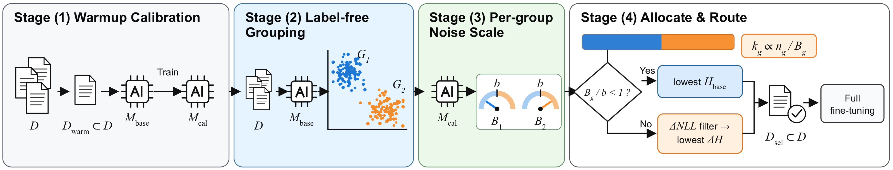
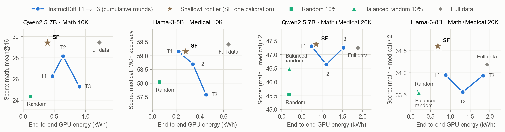
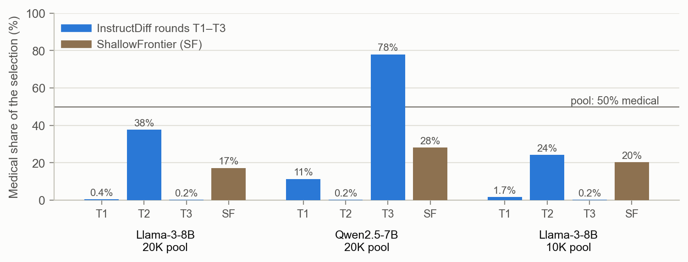

<p align="center">
  <b>English</b>&nbsp;&nbsp;|&nbsp;&nbsp;<a href="README.ko.md">한국어</a>
</p>

<p align="center">
  
</p>

<p align="center">
  <a href="https://aclanthology.org/2026.acl-long.486/"></a>
  <a href="#results"></a>
  <a href="LICENSE"></a>
  
  <a href="https://github.com/hufs24lsh/data-selection/actions/workflows/ci.yml"></a>
</p>

<p align="center">
  <b>Seungho Lee</b>&nbsp;&nbsp;·&nbsp;&nbsp;<b>Suchan Yang</b><br>
  LAIGHT · Hankuk University of Foreign Studies
</p>

<p align="center">
  <a href="#overview">Overview</a>&nbsp;&nbsp;·&nbsp;&nbsp;<a href="#results">Results</a>&nbsp;&nbsp;·&nbsp;&nbsp;<a href="#quick-start">Quick start</a>&nbsp;&nbsp;·&nbsp;&nbsp;<a href="docs/method.md">Method</a>&nbsp;&nbsp;·&nbsp;&nbsp;<a href="docs/evaluation.md">Evaluation</a>&nbsp;&nbsp;·&nbsp;&nbsp;<a href="#reproducibility">Reproducibility</a>&nbsp;&nbsp;·&nbsp;&nbsp;<a href="#citation">Citation</a>
</p>

> [!TIP]
> **TL;DR.** InstructDiff repeats *calibrate → select → train* three times and keeps the best round. ShallowFrontier calibrates
> **once**, reads each prompt group's **learning phase** from its gradient noise, and selects differently in each phase. On four
> testbeds it matches or beats InstructDiff's best round with **53% less end-to-end GPU energy** than InstructDiff and **61% less**
> than training on the full data.

## News

- **2026-11-11** · Code, testbed configurations and results released: seed-42 tables with full-data and random baselines, and 3-seed
  means ± std for every testbed.

## Overview

<p align="center">
  
</p>

**Why it matters.** Data selection is meant to save compute, yet its own cost is rarely counted. Once selection compute is included,
many powerful selection methods are almost never compute-optimal ([Yin & Rush, ICLR 2025](https://arxiv.org/abs/2410.16208)); the
development runs that are usually left unreported cost about half as much as final training
([Morrison et al., ICLR 2025](https://arxiv.org/abs/2503.05804)); and efficiency claims without energy numbers are incomplete
([Chiu, ICML 2026](https://icml.cc/virtual/2026/poster/67123)). We therefore report end-to-end GPU energy, selection included, for
every method.

ShallowFrontier selects 10% of an instruction-tuning pool for full fine-tuning. Instead of the repeated calibration rounds of
[InstructDiff](https://aclanthology.org/2026.acl-long.486/) (Su et al., ACL 2026), it runs **one shallow calibration**, groups the
pool from the **prompts alone**, and measures each group's **learning phase**: whether the group's gradient noise scale *B* is below or
above the training batch size *b*. Below the boundary the group contributes its easiest rows; above it, InstructDiff's
contrastive-entropy order. Shares are proportional to *n / B*, so no group, and no domain of a mixed pool, is starved. No domain labels,
reference answers or data-fitted constants are used.

| Stage | What it does | Code |
|---|---|---|
| **1 · Warm-up calibration** | trains a calibration model M_cal on a random 10% (InstructDiff's warm-up rule), once | [`scripts/train.py`](scripts/train.py) |
| **2 · Label-free grouping** | cosine k-means on base-model prompt features; below silhouette 0.25 the pool stays one group | [`grouping.py`](src/shallowfrontier/grouping.py) |
| **3 · Per-group noise scale** | measures each group's gradient noise scale *B* on M_cal until the selection is settled | [`noise.py`](src/shallowfrontier/noise.py) |
| **4 · Allocate & route** | shares *k ∝ n / B*; *B < b* takes the lowest H_base rows, otherwise the ΔNLL filter, then the lowest ΔH | [`selection.py`](src/shallowfrontier/selection.py) |

<details>
<summary><b>Why two routes?</b></summary>

<br>

The gradient noise scale *B* is the number of examples needed to average out how much per-example gradients disagree. If *B < b*, one
batch already averages the disagreement away: what is left to learn in the group is a shared direction, typically the answer format,
and the rows the base model finds easiest show it most cleanly. If *B ≥ b*, rows pull in different directions and carry their own
content, so InstructDiff's contrast between the base and calibrated models picks the rows that still teach something. On the same Qwen
math rows, changing the training recipe moves *B / b* from 0.27 to 1.49 and flips the winner between the two rules (+2.22 and −1.84
points, seed 42). Next, each testbed is rerun with the other rule forced in every group, to test that the route *B / b* picks is the
better one. Evidence and limitations: [`docs/method.md`](docs/method.md#6-why-two-routes); the test plan:
[`docs/method.md`](docs/method.md#8-next-testing-the-phase-rule).

</details>

<details>
<summary><b>Why group first?</b></summary>

<br>

*B* is a property of a set of rows, not of one row. With one pooled *B* there is one rule for the whole pool and nothing to allocate
between groups. In our pools the pooled *B* gave the same route as the group values, so the gain of grouping comes from the *n / B*
shares: on the Llama-3-8B mixed pools a single ranking keeps almost no medical rows and scores 30.36 and 29.70, against 34.61 and
34.05 with groups (seed 42). Leaning the shares the other way, toward the noisier groups (*n · B*), loses 1.22 and 1.87 points on the
same pools, and splitting by group size alone (*n*) scores lower on all three mixed pools. Groups also let the measurement use a small
sample per group. Prompt groups recover the domains with
97–99% purity and no labels; whether they are the best units in gradient space has not been tested directly yet. Details: [`docs/method.md`](docs/method.md#7-why-group-first).

</details>

<details>
<summary><b>Why the name?</b></summary>

<br>

*Shallow*: one calibration run, no rounds. *Frontier*: the phase boundary *B = b* (critical batch size, McCandlish et al., 2018).
*Asymmetric*: each group gets its own route and share. *Prefix*: groups come from the prompt, the prefix of every example; the response
is never read for grouping. *Extrapolation*: a small held-out sample, measured until the decision is settled, sets the phase of a whole
group, and a short calibration run predicts what the full fine-tune needs.

</details>

## Highlights

- **53% less end-to-end GPU energy than InstructDiff** (selection + final fine-tuning, measured with NVML, mean of four testbeds:
  0.55 vs 1.17 kWh). InstructDiff's best round is only known after all three rounds, so its cost is the cost of three rounds.
- **61% less energy than full-data training** (0.55 vs 1.42 kWh), within 0.3 points of it on the single-domain pools and above it on
  the mixed pools (seed 42).
- **Label-free and answer-free.** Base-model hidden states of the prompts give the groups; mixed math + medical pools split into
  groups that are 97–99% pure without any domain tag.
- **Measured, not tuned.** The routing threshold (*B/b = 1*), the silhouette floor (0.25) and the stopping rule come from theory or
  textbooks; nothing is fitted to our pools.
- **No starved domain.** On the mixed pools (50% medical) InstructDiff's rounds keep between 0.2% and 78% medical rows; ShallowFrontier
  keeps 17–28% (seed 42).
- **Byte-exact reproduction.** From the saved scores and features of our runs, the released code reproduces all 15 selections
  (5 testbeds × 3 seeds), all 17 calibration subsets and both mixed pools byte for byte.

## Results

> [!NOTE]
> Main tables: seed 42 for every method and testbed; 3-seed means ± std (seeds 42–44) are below.

Score = math mean@16 for math, multiple-choice (MCF) accuracy for medical, and their mean for mixed pools; E2E kWh = measured GPU
energy of selection + final fine-tuning. **Bold**: best 10% selection.

| Method | Qwen2.5-7B · Math 10K | kWh | Llama-3-8B · Medical 10K | kWh | Qwen2.5-7B · Mixed 20K | kWh | Llama-3-8B · Mixed 20K | kWh |
|---|---:|---:|---:|---:|---:|---:|---:|---:|
| Base model | 12.06 | – | 62.22 | – | 39.15 | – | 32.21 | – |
| Full data | 29.44 | 1.22 | 59.42 | 0.64 | 47.25 | 1.88 | 34.19 | 1.93 |
| Random 10% | 24.36 | 0.12 | 58.04 | 0.06 | 45.54 | 0.19 | 33.57 | 0.19 |
| Balanced random 10% (half per domain) | – | – | – | – | 46.49 | 0.19 | 33.55 | 0.20 |
| InstructDiff T1 | 26.27 | 0.47 | **59.16** | 0.22 | 47.31 | 0.74 | 33.95 | 0.88 |
| InstructDiff T2 | 28.16 | 0.64 | 58.70 | 0.34 | 46.64 | 1.10 | 33.57 | 1.31 |
| InstructDiff T3 (all three rounds) | 25.27 | 0.90 | 57.59 | 0.45 | 47.25 | 1.52 | 33.94 | 1.83 |
| **ShallowFrontier** | **29.42** | 0.39 | **59.16** | 0.28 | **47.38** | 0.85 | **34.61** | 0.68 |

- On the medical-only pool ShallowFrontier picks exactly InstructDiff T1's rows (one group, *B/b* > 1), so the scores are equal.
- On the medical-only pool every fine-tuned model scores below the base model under MCF scoring; selection decides how little is lost.

**3-seed means** (seeds 42–44, mean ± std; **bold**: best 10% selection):

| Method | Qwen2.5-7B · Math 10K | Llama-3-8B · Medical 10K | Qwen2.5-7B · Mixed 20K | Llama-3-8B · Mixed 20K |
|---|---:|---:|---:|---:|
| Random 10% | 24.38 ± 0.80 | **58.99 ± 0.83** | – | – |
| Balanced random 10% (half per domain) | – | – | 46.27 ± 0.44 | 33.85 ± 0.51 |
| InstructDiff T1 | 26.06 ± 0.28 | 58.58 ± 0.74 | **47.23 ± 0.12** | 33.87 ± 0.08 |
| InstructDiff T2 | 28.18 ± 0.20 | 58.02 ± 0.60 | 46.07 ± 0.50 | 33.40 ± 0.27 |
| InstructDiff T3 | 25.31 ± 0.39 | 58.02 ± 0.65 | 47.14 ± 0.11 | 34.05 ± 0.12 |
| **ShallowFrontier** | **29.13 ± 0.57** | 58.58 ± 0.74 | 47.01 ± 0.32 | **34.15 ± 0.42** |

Against InstructDiff's best round, ShallowFrontier is +0.95 on the math pool and equal on the medical pool (the same rows as T1); on the
Qwen2.5-7B mixed pool it is 0.22 lower, within seed noise (its seed-to-seed std is 0.32), and on the Llama-3-8B mixed pool +0.10. On the
medical-only pool random 10% has the highest 3-seed mean.

<p align="center">
  
</p>
<p align="center">
  
</p>

**Mixed-pool problem case (Llama-3-8B, 10K pool, seed 42).** InstructDiff's third round keeps 2 medical rows out of 1,000 and its score
falls to 28.96 (MedQA 35.27, near chance); ShallowFrontier keeps 203 and scores 34.05.

| Method | Score | kWh |
|---|---:|---:|
| Balanced random 10% | 33.06 | 0.10 |
| InstructDiff T1 / T2 / T3 | 33.01 / 33.34 / 28.96 | 0.43 / 0.65 / 0.90 |
| **ShallowFrontier** | **34.05** | 0.35 |

3-seed means: balanced random 33.41 ± 0.40, InstructDiff T1 / T2 / T3 32.85 ± 0.58 / 33.31 ± 0.47 / 31.20 ± 2.06, ShallowFrontier
33.81 ± 0.22.

<details>
<summary><b>Per-benchmark scores (seed 42)</b></summary>

<br>

Generated from `results/seed42.json`. Rows without results yet are omitted.

**Qwen2.5-7B · Math 10K**

| Method | MATH500 | Minerva | OlympiadBench | AIME24 | AMC23 | Math avg |
|---|---:|---:|---:|---:|---:|---:|
| Base model | 26.66 | 8.43 | 8.04 | 1.24 | 15.94 | 12.06 |
| Full data | 59.97 | 21.01 | 24.36 | 6.25 | 35.62 | 29.44 |
| Random 10% | 54.19 | 12.04 | 20.59 | 3.75 | 31.25 | 24.36 |
| InstructDiff T1 | 56.23 | 14.22 | 23.03 | 5.83 | 32.03 | 26.27 |
| InstructDiff T2 | **59.86** | **20.17** | 25.24 | 5.83 | 29.69 | 28.16 |
| InstructDiff T3 | 54.89 | 13.60 | 21.41 | 7.08 | 29.38 | 25.27 |
| **ShallowFrontier** | 59.22 | 17.67 | **25.71** | **8.55** | **35.94** | **29.42** |

**Llama-3-8B · Medical 10K**

| Method | MedQA | MMLU-Med | MedMCQA | Medical avg |
|---|---:|---:|---:|---:|
| Base model | 58.21 | 71.23 | 57.21 | 62.22 |
| Full data | 54.28 | 69.08 | 54.89 | 59.42 |
| Random 10% | 53.57 | 66.19 | 54.34 | 58.04 |
| InstructDiff T1 | **54.67** | 68.16 | **54.64** | **59.16** |
| InstructDiff T2 | 53.97 | **68.57** | 53.57 | 58.70 |
| InstructDiff T3 | 53.57 | 65.94 | 53.26 | 57.59 |
| **ShallowFrontier** | **54.67** | 68.16 | **54.64** | **59.16** |

**Qwen2.5-7B · Math+Medical 20K**

| Method | MATH500 | Minerva | OlympiadBench | AIME24 | AMC23 | Math avg | MedQA | MMLU-Med | MedMCQA | Medical avg | Score |
|---|---:|---:|---:|---:|---:|---:|---:|---:|---:|---:|---:|
| Base model | 26.66 | 8.43 | 8.04 | 1.24 | 15.94 | 12.06 | 61.98 | 78.02 | 58.71 | 66.24 | 39.15 |
| Full data | 60.99 | 20.16 | 23.12 | 6.26 | 32.50 | 28.61 | 61.43 | 77.98 | 58.28 | 65.90 | 47.25 |
| Random 10% | 55.96 | 13.98 | 20.61 | 4.38 | 31.09 | 25.21 | **62.37** | 76.74 | 58.50 | **65.87** | 45.54 |
| Balanced random 10% | 57.00 | 15.48 | 22.19 | **6.66** | 35.16 | 27.30 | 61.19 | **77.25** | **58.62** | 65.69 | 46.49 |
| InstructDiff T1 | 61.02 | 19.45 | **23.86** | 5.84 | 34.48 | 28.93 | 61.82 | 76.89 | 58.37 | 65.69 | 47.31 |
| InstructDiff T2 | 58.01 | 16.86 | 23.44 | 4.99 | 34.84 | 27.63 | 61.43 | 77.04 | 58.47 | 65.65 | 46.64 |
| InstructDiff T3 | **61.75** | 18.19 | 23.43 | 5.61 | **37.19** | **29.23** | 60.72 | 77.18 | 57.90 | 65.27 | 47.25 |
| **ShallowFrontier** | 61.44 | **20.24** | 23.71 | 4.78 | 35.47 | 29.13 | 62.22 | 76.82 | 57.85 | 65.63 | **47.38** |

**Llama-3-8B · Math+Medical 20K**

| Method | MATH500 | Minerva | OlympiadBench | AIME24 | AMC23 | Math avg | MedQA | MMLU-Med | MedMCQA | Medical avg | Score |
|---|---:|---:|---:|---:|---:|---:|---:|---:|---:|---:|---:|
| Base model | 3.42 | 2.09 | 1.51 | 0.21 | 2.81 | 2.01 | 58.60 | 71.38 | 57.23 | 62.40 | 32.21 |
| Full data | 22.69 | 8.14 | 5.55 | 0.62 | 6.88 | 8.78 | 55.54 | 69.08 | 54.17 | 59.60 | 34.19 |
| Random 10% | 17.67 | 6.64 | 3.99 | 0.41 | 6.88 | 7.12 | 55.77 | 68.35 | 55.96 | 60.03 | 33.57 |
| Balanced random 10% | 18.49 | **6.99** | 4.17 | 0.21 | 5.47 | 7.07 | 56.25 | 69.70 | 54.17 | 60.04 | 33.55 |
| InstructDiff T1 | 18.96 | 6.42 | **4.79** | 0.21 | **8.28** | 7.73 | 54.36 | 70.32 | 55.85 | 60.17 | 33.95 |
| InstructDiff T2 | **19.50** | 5.94 | 4.43 | 0.00 | 7.03 | 7.38 | 54.75 | 70.24 | 54.29 | 59.76 | 33.57 |
| InstructDiff T3 | 18.30 | 6.11 | 4.67 | 0.41 | 7.03 | 7.30 | 54.91 | 69.92 | **56.90** | 60.57 | 33.94 |
| **ShallowFrontier** | 19.16 | 6.90 | 4.54 | **0.62** | 7.66 | **7.78** | **57.74** | **70.90** | 55.68 | **61.44** | **34.61** |

**Llama-3-8B · Math+Medical 10K** (mixed-pool problem case)

| Method | MATH500 | Minerva | OlympiadBench | AIME24 | AMC23 | Math avg | MedQA | MMLU-Med | MedMCQA | Medical avg | Score |
|---|---:|---:|---:|---:|---:|---:|---:|---:|---:|---:|---:|
| Base model | 3.42 | 2.09 | 1.51 | 0.21 | 2.81 | 2.01 | 58.60 | 71.38 | 57.23 | 62.40 | 32.21 |
| Balanced random 10% | 15.34 | 5.18 | 3.54 | 0.21 | 5.62 | 5.98 | 55.22 | 70.24 | 54.96 | 60.14 | 33.06 |
| InstructDiff T1 | **16.86** | 5.70 | 4.16 | **0.41** | 7.34 | **6.90** | 51.92 | 69.11 | **56.35** | 59.13 | 33.01 |
| InstructDiff T2 | 16.02 | 5.60 | 3.66 | 0.21 | 6.25 | 6.35 | 55.30 | **70.76** | 54.96 | 60.34 | 33.34 |
| InstructDiff T3 | 16.28 | **6.20** | 3.98 | 0.21 | 5.00 | 6.33 | 35.27 | 63.64 | 55.87 | 51.59 | 28.96 |
| **ShallowFrontier** | 16.29 | 5.20 | **4.18** | 0.21 | **7.81** | 6.74 | **57.03** | **70.76** | 56.30 | **61.36** | **34.05** |

</details>

## Quick start

### Installation

```bash
git clone https://github.com/hufs24lsh/data-selection.git && cd data-selection
pip install -e .                                       # selection pipeline (CPU steps)
pip install -r requirements/requirements_train.txt     # GPU steps and training (PyTorch for your CUDA)
pip install -r requirements/requirements_eval.txt      # evaluation (vLLM); a separate environment is recommended
python -m pytest -q                                    # unit tests, CPU only
```

### Data

The pools are InstructDiff's training files; they are not redistributed. Copy them into `data/` and build the mixed pools
(row orders are stored in `data/mixed/*.order.json`; SHA-256 values are checked):

```bash
python scripts/make_mixed_pools.py
```

Details and checksums: [`data/README.md`](data/README.md).

### Run one testbed

End to end (calibration → scoring → grouping → noise → selection → final fine-tuning → evaluation):

```bash
bash scripts/run_shallowfrontier.sh configs/testbeds/qwen_mix20k.yaml 42
```

The five testbed configurations are in [`configs/testbeds/`](configs/testbeds/). Our runs used two 32 GB GPUs for training and one for
feature extraction, scoring and noise measurement.

<details>
<summary><b>Step by step</b></summary>

<br>

```bash
# 1. Calibration subset (InstructDiff's warm-up rule) and calibration model
python -m shallowfrontier.cli calibration --pool data/mixed/math10k_med10k_seed42.jsonl --k 2000 --limit 20000 --seed 42 --out runs/x/calibration.jsonl
python scripts/train.py --model Qwen/Qwen2.5-7B --data runs/x/calibration.jsonl --out runs/x/calibration_model --lr 2e-5 --batch 64 --max-length 2048

# 2. InstructDiff scores (base vs calibrated) and prompt-only grouping
python -m shallowfrontier.cli score    --base Qwen/Qwen2.5-7B --calibrated runs/x/calibration_model --pool data/mixed/math10k_med10k_seed42.jsonl --out runs/x/scored.jsonl
python -m shallowfrontier.cli features --model Qwen/Qwen2.5-7B --pool data/mixed/math10k_med10k_seed42.jsonl --out runs/x/features.npy
python -m shallowfrontier.cli group    --features runs/x/features.npy --out runs/x/groups.json

# 3. Per-group noise scale, measured until the selection is settled (b = the recipe's global batch)
python -m shallowfrontier.cli noise --model runs/x/calibration_model --tokenizer Qwen/Qwen2.5-7B --pool data/mixed/math10k_med10k_seed42.jsonl \
    --calibration runs/x/calibration.jsonl --groups runs/x/groups.json --k 2000 --batch 64 --seed 42 --out runs/x/noise.json

# 4. Shares n/B and routes B/b -> the selected 10%, then the final fine-tune
python -m shallowfrontier.cli select --pool data/mixed/math10k_med10k_seed42.jsonl --scores runs/x/scored.jsonl --groups runs/x/groups.json \
    --noise runs/x/noise.json --k 2000 --batch 64 --out runs/x/selected.jsonl
python scripts/train.py --model Qwen/Qwen2.5-7B --data runs/x/selected.jsonl --out runs/x/final_model --lr 2e-5 --batch 64 --max-length 2048
```

InstructDiff's own round-1 `scored.jsonl` can replace step 2's scoring; our runs used it.

</details>

### Evaluation

```bash
# Math: five benchmarks, mean accuracy over 16 samples at temperature 1
cd eval/math_evaluation && bash sh/eval.sh alpaca <model_dir> <output_dir> 16 1
# Medical: MedQA, MMLU-medical, MedMCQA with multiple-choice (MCF) scoring
python eval/medeval/mcf_eval.py --model <model_dir> --out <result.json>
# The released InstructDiff rule, for comparison
python eval/medeval/mcf_eval.py --model <model_dir> --out <result.json> --protocol released
```

> [!IMPORTANT]
> **Medical scoring.** The released InstructDiff medical script reads the top-10 first tokens and, when one option letter appears in
> several forms (`' B'`, `'B'`, `' b'`), keeps the last and least likely one, which can turn a confident correct answer into a wrong one.
> We report MCF scores and keep the released rule for comparison. See [`docs/evaluation.md`](docs/evaluation.md).

## Reproducibility

The released code was run on the saved artifacts of our experiments, and its outputs were compared byte for byte:

| Check | Result |
|---|---|
| Selections from saved scores, groups and noise (5 testbeds × seeds 42, 43, 44) | 15 / 15 identical |
| Calibration subsets of every calibration run | 17 / 17 identical |
| Mixed pools from InstructDiff's source files | 2 / 2 identical |
| Groups from saved prompt features (5 testbeds) | 5 / 5 identical |

The noise measurement and the scorer have not yet been re-run on GPU with this code. Hardware, software, recipes, seeds, energy
accounting and the known differences from the InstructDiff paper: [`docs/reproducibility.md`](docs/reproducibility.md).

## Repository structure

```
src/shallowfrontier/   grouping, noise measurement, selection, scoring, command line
src/instdiff/          training code adapted from InstructDiff (see License)
scripts/               training, end-to-end pipeline, mixed-pool builder, figures
configs/testbeds/      the five testbeds (model, pool, recipe, evaluation)
eval/                  math evaluation harness and the medical MCF evaluation
data/                  data instructions and mixed-pool row orders
results/               final numbers behind the tables and figures
docs/                  method, evaluation and reproducibility notes
```

## Citation

If you find this work useful, please cite:

```bibtex
@misc{shallowfrontier2026,
  title  = {ShallowFrontier: Energy-Efficient LLM Data Selection via Asymmetric Prefix Extrapolation},
  author = {Lee, Seungho and Yang, Suchan},
  year   = {2026},
  url    = {https://github.com/hufs24lsh/data-selection}
}
```

## License

This project is released under the [MIT License](LICENSE). Two components keep their own terms:

- `src/instdiff/train_v2.py` is adapted from [InstructDiff](https://github.com/zhuchichi56/Instruct-diff) (MIT, as stated in its README).
  The two modifications are marked in the file.
- `eval/math_evaluation/` is adapted from [math-evaluation-harness](https://github.com/ZubinGou/math-evaluation-harness)
  (MIT, license kept in that folder).

The training pools and evaluation sets remain under the licenses of their original datasets (NuminaMath-CoT, MedMCQA, MedQA, MMLU).
The pools are not redistributed: `data/mixed/*.order.json` holds row indices only.

## Acknowledgements

We thank the authors of InstructDiff for releasing their code and data, and the authors of math-evaluation-harness for the math
evaluation suite. Questions and bug reports are welcome as [issues](https://github.com/hufs24lsh/data-selection/issues).

The earlier prototype of this repository (response-prefix scoring with K = 128/256) is preserved under the tag
`v0-shallowfrontier-prototype`.
